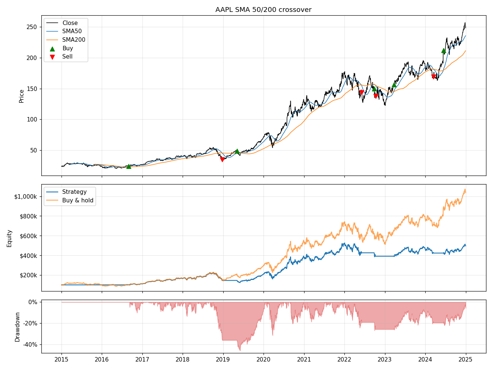

# backtesting-engine

A small event-driven backtester for daily long/flat strategies, written in Python. It ships with a 50/200-day moving average crossover and compares it against buy and hold.



## How it works

- `data.py` downloads split/dividend-adjusted daily bars from Yahoo Finance and rejects missing or non-positive prices.
- A strategy (`strategies/`) returns a target position for each day: 1 = long, 0 = cash. It can only use data up to that day's close.
- `engine.py` walks through the bars. A target decided at day t's close is filled at day t+1's open, so a signal never trades on the price that created it. Each fill pays slippage (fill price moved against you) plus commission, both in basis points.
- Equity is marked to market at every close, which gives a daily return series.
- `metrics.py` computes total return, CAGR, annualized volatility, Sharpe, Sortino, max drawdown, hit rate (share of closed trades with positive net P&L) and exposure (share of days invested).

## Usage

```
pip install -r requirements.txt
python main.py                                   # AAPL, 2015-2024, SMA 50/200
python main.py --symbol SPY --fast 20 --slow 100 --plot spy.png
python main.py --commission-bps 0 --slippage-bps 10 --risk-free 0.03
```

Run the tests with:

```
python -m unittest discover -s tests -t .
```

## Results

AAPL and SPY, 2015-01-01 to 2025-01-01, $100k starting capital, 1 bp commission + 5 bps slippage per fill, risk-free rate 0:

| | AAPL SMA 50/200 | AAPL buy & hold | SPY SMA 50/200 | SPY buy & hold |
|---|---|---|---|---|
| Total return | 396.5% | 937.7% | 132.4% | 241.4% |
| CAGR | 17.4% | 26.4% | 8.8% | 13.1% |
| Volatility | 23.6% | 28.4% | 14.1% | 17.6% |
| Sharpe | 0.80 | 0.97 | 0.67 | 0.79 |
| Max drawdown | -45.9% | -38.5% | -33.7% | -33.7% |
| Hit rate | 75% (3 of 4) | n/a | 50% (2 of 4) | n/a |
| Exposure | 69.6% | 100% | 74.0% | 100% |

The crossover lost to buy and hold on both tickers, on return and on Sharpe. It spends about 30% of the time in cash, and over this window that mostly meant missing rebounds: on AAPL it sold on 2018-12-24, close to the bottom, and bought back in May 2019 about 40% higher. Lower volatility did not translate into a smaller drawdown. Four round trips per ticker is also far too few to say anything statistically, so the hit rates above are not meaningful on their own.

## Limitations

- Long/flat, one asset at a time, whole shares only.
- Fills at the open with a flat slippage assumption; no volume or market-impact model.
- No parameter search, so no in-sample/out-of-sample split is needed yet. Any tuning of the windows should be done on one period and tested on another.

## Adding a strategy

Subclass `Strategy` and return a 0/1 series:

```python
class Momentum(Strategy):
    def generate_signals(self, data):
        return (data["Close"].pct_change(126) > 0).astype(int)
```

Then pass it to `Engine(Momentum(), "SPY", "2015-01-01", "2025-01-01")`.
